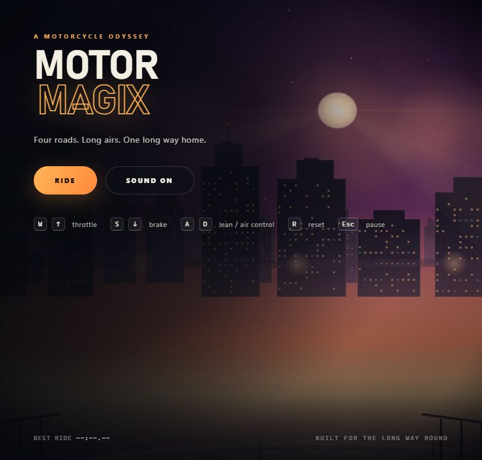

# Motor Magix

**A Motorcycle Odyssey** — a side-scrolling motorcycle time-trial game that runs entirely in the browser. Four procedurally built roads, long jumps, and one very long way home.



## The game

You ride a heavy dirt bike along a rolling landscape, holding the throttle to build speed and using the terrain to launch off ramps and over gaps. Each road is a point-to-point sprint against the clock, not a lap race.

- **Four roads**, each with its own landscape, palette, music, and jump layout:
  1. **Neon Overpass** — dusk freeways and a burning city skyline
  2. **Golden Meadows** — warm fields, fences, and a long valley
  3. **Monsoon Ruins** — wet jungle stone under a heavy canopy
  4. **Canyon Mirage** — red rock mesas and a locked bonus road
- **Time-trial scoring** — finish a road to record a personal best. Gold, silver, and bronze medals are awarded for target times; the best time and medals are saved per road.
- **Checkpoints and splits** — gates spaced along each road, with live comparisons against your best run's splits.
- **Air time is the point** — the HUD tracks total air time and your biggest single jump, with "AIR / BIG AIR / MASSIVE AIR" callouts on landing.
- **Crashes and resets** — land on your bars or loop the bike and you wipe out, then respawn at the last checkpoint. A stuck detector also resets you automatically. `R` resets manually.
- **Progression** — the fourth road unlocks after you complete the first three. Total ride time across all roads is shown in the roadbook.
- **Controls** — `W`/`↑` throttle, `S`/`↓` brake, `A`/`D` or `←`/`→` lean and control the bike in the air, `R` reset, `Esc`/`P` pause, `M` mute. On touch devices, on-screen pads provide throttle, brake, lean, pause, and reset.
- **Presentation** — animated parallax scenery, drifting clouds, stars, valley mist, dust and spark particles, camera shake, speed streaks, god rays, film grain, and a responsive HUD. The game is designed for landscape but will run in portrait with a "turn your device" nudge.

## Technology

The project is a **dependency-free static web game**: plain HTML, CSS, and modern JavaScript (ES6 classes, `Path2D`, `Float32Array`, Web Audio). There is no framework, bundler, package manager, build step, or external asset pipeline. Every visual and sound is generated at runtime.

### Rendering — Canvas 2D

- A single full-screen `<canvas>` draws the scene; the DOM and CSS handle the HUD and menus.
- The world is a **2D side-on simulation with pseudo-3D presentation**: a custom camera projects world metres to pixels, and scenery is layered with different parallax factors.
- **Procedural scenery**: gradient skies, sun discs and halos, cloud sprites pre-rendered to offscreen canvases, twinkling stars, distant silhouettes (city, hills, jungle, mesa), roadside props, foreground foliage/rocks, and post effects (colour grade, vignette, god rays, flash, fade).
- **Procedural bike art**: frame, forks, exhaust, rider, spinning wheels, tread, and spokes are drawn with canvas paths each frame.
- DPR-aware resizing (capped at 1.75×) keeps the game crisp without excessive fill cost.

### Physics and simulation

- A custom **rigid-chassis motorcycle model** with two spring/damper suspension units, wheel compression and travel, separate compression/rebound damping, progressive bump stops, and tire grip limits.
- Engine force falls off with speed; braking, rolling resistance, aerodynamic drag, and wheel slip are modelled. The rear wheel spins up under throttle; tire load affects available grip.
- **Air control and landing assists**: lean torque in the air, automatic attitude damping toward the flight path, and a gentle alignment assist when close to the ground.
- **Fixed-timestep simulation** at 120 Hz, driven by an accumulator in the render loop with a `0.86` time scale. This keeps physics stable across frame rates.
- Crash detection covers body contact, inverted/loop landings, and falling below the surface. Terrain contact uses ray-style probing with binary search against the heightfield.

### Terrain generation

- Roads are **heightfields** built from a smooth base (trend + layered sine waves) plus authored feature types: ramps, trenches/gaps, landings, tables, whoops, drops, and bumps.
- A seeded deterministic RNG (`mulberry32`-style) creates a repeatable "flow > gap > whoops > table > gap" rhythm per road, with per-level jitter and difficulty.
- Height and slope are sampled once at 0.1 m intervals into `Float32Array` caches, then interpolated at runtime. Checkpoints snap to safe zones between features.
- `tests/selftest.html` is a headless harness that builds every road, checks terrain continuity and settling, then simulates a full-throttle run to the finish.

### Audio — Web Audio API

- **All music and sound effects are synthesized live**; there are no audio files.
- A look-ahead step sequencer generates four musical flavours (`synthwave`, `funk`, `jungle`, `cinematic`) from per-level chord progressions, tempo, and 16-step drum/bass/arp patterns.
- Instruments are built from oscillators, filtered noise, envelopes, a generated convolution reverb, and a feedback delay. Kick drums sidechain the pads.
- Continuous ride sound layers a two-oscillator engine, wind noise, and rolling/ground noise, all modulated by speed, throttle, and whether the bike is grounded. Music intensity rises with speed and air time.
- One-shot effects cover crashes, landings, checkpoints, countdown ticks, and the finish fanfare.

### UI, input, and persistence

- The HUD, title screen, roadbook, pause screen, results panel, countdown, and touch controls are **HTML/CSS overlays** driven by class-based state changes.
- Keyboard and touch share a smoothed analog input model (throttle, brake, lean) with pointer-event support for multi-touch.
- Progress (best times, best splits, medals, unlocked roads, mute setting) is stored in `localStorage` under `ltt.progress.v1`. Saves fail gracefully in private mode.
- The audio context is created lazily on first input to satisfy browser autoplay policies.

## Project structure

```
index.html            Markup: canvas, HUD, screens, touch controls
docs/title-screen.jpg Screenshot of the opening screen
css/style.css         All UI styling, layout, responsive and state rules
js/util.js            Math helpers, deterministic RNG, hashing, formatting
js/input.js           Keyboard + touch input, smoothing, pause/reset queue
js/terrain.js         Heightfield Track class and procedural track planner
js/levels.js          Four road definitions (palettes, music, layouts) and track factory
js/bike.js            Motorcycle rigid-body physics, suspension, tires, crashes
js/audio.js           Web Audio synthesis, sequencer, engine/wind/effects
js/render.js          Camera, terrain painting, particles, scene composition
js/render-art.js      Procedural sky, parallax backdrops, props, bike art, post FX
js/ui.js              Screens, HUD updates, medals, localStorage progress
js/main.js            Game loop, run state, checkpoints, timing, debug hooks
tests/selftest.html   Headless physics/terrain test harness
```

## Running it

Open `index.html` in a modern browser. That is enough — there is nothing to install or build.

For a more browser-like environment (and for the self-test), serve the folder over HTTP:

```sh
python -m http.server 8080
# then open http://localhost:8080/
```

Run the physics self-test at `http://localhost:8080/tests/selftest.html`. It prints per-road results and sets the page title to `DONE`.

### Development and debug hooks

Query parameters on `index.html` expose extra state for testing:

| Parameter | Effect |
| --- | --- |
| `?debug=1` | Show the live physics/FPS debug overlay |
| `?level=0..3` | Start on a specific road |
| `?screen=title\|select\|pause\|results` | Jump directly to a screen |
| `?unlock=1` | Mark the first three roads complete (unlocks road four) |
| `?audio=0` | Disable audio |
| `?touch=1` / `?touch=0` | Force touch controls on or off |
| `?auto=1&pose=X&vx=Y&fast=N` | Auto-drive from a position for N seconds |
| `?frames=N` | Stop after N frames (used by headless screenshots) |

## Browser support

Current versions of Chrome, Edge, Firefox, and Safari. The game needs Canvas 2D, `Path2D`, `localStorage`, pointer events, and (for sound) the Web Audio API. Audio starts only after the first interaction, as required by browser autoplay rules.
